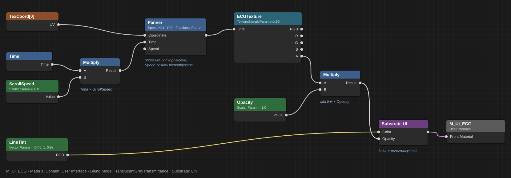

# Animacja EKG w UMG — instrukcja krok po kroku

Tekstura przewija się w materiale (węzeł `Time`), a widget tylko zmienia parametry materiału. Nie potrzeba Tick ani timerów, żeby EKG się ruszało.

Przy każdym ustawieniu jest link **>>**. Prowadzi do krótkiego wyjaśnienia na końcu dokumentu, a stamtąd link **↑ wróć** przenosi z powrotem.

## 1. Import tekstur

Zaimportuj pliki z `ReadyForImport/` (np. do `Content/HUD/ECG/`):

- `T_HUD_ECG_Calm_Loop_1024x256.png`
- `T_HUD_ECG_Normal_Loop_1024x256.png`
- `T_HUD_ECG_Damage_Loop_1024x256.png`

Potem kliknij dwukrotnie każdą teksturę i ustaw w panelu Details:

<a id="set-compression"></a>
- **Compression Settings** → `Uncompressed (RGBA8)` [>>](#why-compression)

<a id="set-group"></a>
- **Texture Group** → `UI` [>>](#why-group)

<a id="set-mips"></a>
- **Mip Gen Settings** → `NoMipmaps` [>>](#why-mips)

<a id="set-srgb"></a>
- **sRGB** → włączone [>>](#why-srgb)

<a id="set-tilex"></a>
- **X-axis Tiling Method** → `Wrap` [>>](#why-tilex)

<a id="set-tiley"></a>
- **Y-axis Tiling Method** → `Clamp` [>>](#why-tiley)

## 2. Materiał `M_UI_ECG`

Utwórz materiał i w panelu Details ustaw:

<a id="set-domain"></a>
- **Material Domain** → `User Interface` [>>](#why-domain)

<a id="set-blend"></a>
- **Blend Mode** → `TranslucentGreyTransmittance` [>>](#why-blend)

Dodaj parametry (prawy klik w grafie → nazwa typu, potem nadaj nazwę): [>>](#why-params)

<a id="set-params"></a>
- `ECGTexture` (TextureSampleParameter2D), domyślnie `T_HUD_ECG_Normal_Loop`
- `ScrollSpeed` (Scalar), domyślnie `1.15`
- `LineTint` (Vector), domyślnie `(0.45, 1.0, 0.9)`
- `Opacity` (Scalar), domyślnie `1.0`

Połącz węzły: [>> Panner](#why-scroll) · [>> kolor z LineTint](#why-alpha)

<a id="set-graph"></a>


```
TexCoord ───────────────────────► Coordinate ┐
Multiply(Time, ScrollSpeed) ────► Time       ┴ [Panner] ──► UVs [ECGTexture]
                                                                    │
LineTint ──────────────────────────────► Color   ┐
ECGTexture.A × Opacity ────────────────► Opacity ┴ [Substrate UI] ──► Front Material
```

W węźle **Panner** (panel Details): **Speed X** = `1`, **Speed Y** = `0`, zaznacz **Fractional Part**. Wejście **Speed** zostaw puste.

<a id="set-substrate"></a>
Węzeł **Substrate UI**: prawy klik w grafie → wpisz „Substrate UI”. Jego wyjście podłącz do **Front Material**. [>>](#why-substrate)

## 3. Widget `WBP_HUD`

<a id="set-image"></a>
1. Dodaj widget **Image**, zaznacz **Is Variable** i nazwij go `ECGImage`. [>>](#why-isvariable)
2. W Brush → Image wybierz `M_UI_ECG` i ustaw rozmiar, np. 256×64.

<a id="set-mid"></a>
3. W **Event Construct**: [>>](#why-mid)

   ```
   Event Construct ─► Get Dynamic Material (Target: ECGImage) ─► Promote to Variable (ECG_MID)
   ```

Samo to wystarczy, żeby EKG się przewijało.

## 4. Zmiana stanu przy obrażeniach

**Plik: `Content/HUD/WBP_HUD` → Graph (Event Graph), dalej za `Promote to Variable (ECG_MID)` w Event Construct**

```
Event Construct ─► … ─► Get Owning Player Pawn ─► Bind Event to OnTakeAnyDamage
                                                   Event: Add Custom Event → OnDamaged
```

<a id="set-damage"></a>
**Plik: `Content/HUD/WBP_HUD` → My Blueprint → Variables**

- Dodaj zmienną `RecoverAlpha` (typ **Float**), **Default Value = `1.0`**. [>> RecoverAlpha zamiast Timeline](#why-timeline)

**Plik: `Content/HUD/WBP_HUD` → Graph (Event Graph), custom event `OnDamaged`** [>> Retriggerable Delay](#why-retrigger)

```
OnDamaged ─► Set RecoverAlpha = 1.0
          ─► Set Texture Parameter Value  (Target: ECG_MID, Name: ECGTexture,  Value: T_HUD_ECG_Damage_Loop)
          ─► Set Scalar Parameter Value   (Target: ECG_MID, Name: ScrollSpeed, Value: 0.75)
          ─► Set Vector Parameter Value   (Target: ECG_MID, Name: LineTint,    Value: R=1, G=0.3, B=0.12)
          ─► Retriggerable Delay (Duration: 0.5)
          ─► Set Texture Parameter Value  (Target: ECG_MID, Name: ECGTexture,  Value: T_HUD_ECG_Normal_Loop)
          ─► Set RecoverAlpha = 0.0
```

**Plik: `Content/HUD/WBP_HUD` → Graph (Event Graph), `Event Tick`** (jest już w grafie, często wyszarzony; jeśli nie ma: prawy klik → Event Tick)

```
Event Tick ─► Branch (Condition: RecoverAlpha < 1.0)
               True ─► Set RecoverAlpha = Min( RecoverAlpha + In Delta Time / 0.8 , 1.0 )
                    ─► Set Scalar Parameter Value (Target: ECG_MID, Name: ScrollSpeed,
                                                   Value: Lerp(A: 0.75, B: 1.15, Alpha: RecoverAlpha))
                    ─► Set Vector Parameter Value (Target: ECG_MID, Name: LineTint,
                                                   Value: Lerp (LinearColor)(A: R=1 G=0.3 B=0.12,
                                                                             B: R=0.45 G=1 B=0.9,
                                                                             Alpha: RecoverAlpha))
               False ─► (nic)
```

- `0.8` to czas powrotu do normy w sekundach.
- `In Delta Time` to pin wyjściowy węzła `Event Tick`.
- `Lerp (LinearColor)` znajdziesz, wpisując „Lerp (LinearColor)” albo „Lerp” i wybierając wersję dla Linear Color.

Płynniejsza podmiana tekstury: `Opacity` do 0 w 0.08 s → podmień teksturę → `Opacity` do 1 w 0.08 s.

**Plik: `Content/FirstPerson/Blueprints/BP_FirstPersonCharacter` → Event Graph (tylko do testu, potem usuń)**

`OnTakeAnyDamage` odpala się tylko po `Apply Damage`. Bez systemu obrażeń przetestuj klawiszem:

```
Keyboard Event K ─► Apply Damage
                     Damaged Actor: Self
                     Base Damage:   10
```

## 5. Stany

| Stan | Tekstura | ScrollSpeed | Rytm | LineTint |
| --- | --- | ---: | ---: | --- |
| Calm | `T_HUD_ECG_Calm_Loop` | `0.75` | ~45 BPM | `(0.35, 0.90, 0.82)` |
| Normal | `T_HUD_ECG_Normal_Loop` | `1.15` | ~69 BPM | `(0.45, 1.00, 0.90)` |
| Damage | `T_HUD_ECG_Damage_Loop` | `0.75` | ~135 BPM (3 piki na pętlę) | `(1.00, 0.30, 0.12)` |

**Calm:** ten sam schemat co Damage. Włączaj go np. po X sekundach bez obrażeń, timerem resetowanym w `OnDamaged`.

## Alternatywa: Widget Animation

Zamiast licznika w Event Tick możesz użyć Widget Animation. Dodaj track `ECGImage` → **Brush → Material parameters** i kluczuj `ScrollSpeed` oraz `LineTint`. W `OnDamaged` wywołaj wtedy **Play Animation**. Podmianę tekstury i tak trzeba zrobić w grafie, bo tego nie da się kluczować.

---

# Dlaczego tak?

Każdy punkt ma ten sam układ: **jednym zdaniem**, potem **co się zepsuje bez tego**. Czytaj tylko to, co cię interesuje.

<a id="why-compression"></a>
### Compression Settings = Uncompressed (RGBA8)

**Jednym zdaniem:** kompresja niszczy cienkie linie, a EKG to jedna cienka linia z miękką poświatą.

- Domyślna kompresja (DXT/BC3) dzieli obrazek na kwadraty 4×4 piksele i uśrednia je.
- Na zdjęciach tego nie widać. Na cienkiej świecącej linii widać schodki i brudne kwadraciki wokół.
- Koszt bez kompresji: ok. 1 MB na teksturę. Przy trzech teksturach to nic.
- Chcesz oszczędzić pamięć? `BC7` wygląda prawie tak samo i zajmuje 4× mniej.
- Edytor pokaże ostrzeżenie „prefer BC7”. Możesz je zignorować.

**Bez tego:** linia EKG ma postrzępione krawędzie i „brudną” poświatę.

[↑ wróć](#set-compression)

<a id="why-group"></a>
### Texture Group = UI

**Jednym zdaniem:** mówi silnikowi „to jest HUD, zawsze pokazuj w pełnej jakości”.

- Silnik oszczędza pamięć, ładując słabszą wersję tekstur, które są daleko od kamery (to tzw. streaming).
- HUD nie jest „daleko”, jest zawsze na ekranie. Grupa UI wyłącza to oszczędzanie.
- Ustawienia jakości grafiki (Low/Medium) też nie obniżą tej tekstury.

**Bez tego:** na niższych ustawieniach grafiki EKG może się zrobić rozmyte.

[↑ wróć](#set-group)

<a id="why-mips"></a>
### Mip Gen Settings = NoMipmaps

**Jednym zdaniem:** mipmapy to pomniejszone kopie tekstury dla obiektów w oddali, a HUD nigdy nie jest w oddali.

- Silnik normalnie robi kopie 512, 256, 128… pikseli i wybiera mniejszą, gdy obiekt jest mały na ekranie.
- Przy pomniejszaniu cienka linia się rozmywa albo znika.
- Bez mipmap zawsze rysowany jest oryginał.
- Bonus: tekstura zajmuje mniej pamięci, bo nie ma kopii.

**Bez tego:** gdy widget jest mały (np. 128 px szerokości), linia może być blada lub poszarpana.

[↑ wróć](#set-mips)

<a id="why-srgb"></a>
### sRGB = włączone

**Jednym zdaniem:** to standardowe ustawienie dla obrazków z kolorem, zostaw je.

- sRGB mówi silnikowi, że plik PNG ma kolory „jak na monitorze”.
- W tym materiale używamy tylko kanału alfa (przezroczystości), a sRGB alfy nie zmienia. Kolor daje `LineTint`.
- Czyli tu to ustawienie praktycznie nic nie zmienia. Zostaw włączone, żeby nie mieszać.

**Bez tego:** nic się nie zepsuje, ale jeśli kiedyś użyjesz koloru z tekstury, będzie za ciemny.

[↑ wróć](#set-srgb)

<a id="why-tilex"></a>
### X-axis Tiling Method = Wrap

**Jednym zdaniem:** dzięki temu po prawej krawędzi tekstura zaczyna się znowu od lewej, czyli pętla.

- Animacja przesuwa teksturę w bok bez końca.
- `Wrap` = „jak wyjdziesz za prawą krawędź, wróć na lewą”. Tekstury są przygotowane tak, że łączenie jest niewidoczne.

**Bez tego:** po chwili linia zamienia się w rozciągnięte paski albo znika.

[↑ wróć](#set-tilex)

<a id="why-tiley"></a>
### Y-axis Tiling Method = Clamp

**Jednym zdaniem:** w pionie nic się nie przewija, więc nie chcemy, żeby góra „przeciekała” na dół.

- Przy wygładzaniu silnik miesza sąsiednie piksele. Z `Wrap` na górnej krawędzi zmieszałby je z pikselami z dolnej krawędzi.
- `Clamp` = „za krawędzią powtarzaj ostatni piksel”.

**Bez tego:** może się pojawić cienka kreska na górze lub dole widgetu, gdy wysoki pik dotyka krawędzi.

[↑ wróć](#set-tiley)

<a id="why-domain"></a>
### Material Domain = User Interface

**Jednym zdaniem:** to mówi „ten materiał jest do widgetów, nie do obiektów 3D”.

- Domyślny materiał (Surface) liczy światło, cienie i odbicia, a w HUD nic z tego nie ma sensu.
- Widget Image przyjmuje tylko materiały z domeną User Interface.

**Bez tego:** materiał się nie wyświetli w widgecie albo dostaniesz błąd.

[↑ wróć](#set-domain)

<a id="why-blend"></a>
### Blend Mode = TranslucentGreyTransmittance / Translucent

**Jednym zdaniem:** potrzebujemy przezroczystości, żeby było widać tylko linię, a nie prostokąt.

- `Opaque` = pełny prostokąt, tło gry zasłonięte.
- `Masked` = przezroczystość tylko „tak/nie”, więc miękka poświata wokół linii znika.
- `Translucent` = płynna przezroczystość, poświata zostaje.
- Dlaczego dziwna nazwa? Projekt ma włączony **Substrate** (`r.Substrate=True` w `Config/DefaultEngine.ini`), a wtedy zwykły Translucent wyświetla się jako `TranslucentGreyTransmittance`. To ten sam tryb.
- `Colored Transmittance` to dodatek Substrate do kolorowego szkła. Do HUD niepotrzebny.

**Bez tego:** czarny lub kolorowy prostokąt zamiast samej linii, albo linia bez poświaty.

[↑ wróć](#set-blend)

<a id="why-params"></a>
### Parametry zamiast stałych

**Jednym zdaniem:** parametr to „pokrętło”, które Blueprint może przekręcić w trakcie gry.

- Zwykła stała jest wpisana na sztywno w materiał.
- Parametr ma nazwę, więc z Blueprintu wołasz np. `Set Scalar Parameter Value (ScrollSpeed, 0.75)`.
- Dzięki temu jeden materiał obsługuje wszystkie stany (Calm, Normal, Damage).

**Bez tego:** do każdego stanu potrzebny byłby osobny materiał.

[↑ wróć](#set-params)

<a id="why-scroll"></a>
### Panner (przewijanie)

**Jednym zdaniem:** Panner przesuwa teksturę w bok, a `Time × ScrollSpeed` mówi mu, jak daleko w danej chwili.

- `TexCoord` = „który punkt tekstury narysować w tym miejscu” (0 = lewa krawędź, 1 = prawa).
- Panner liczy `TexCoord + Time × Speed`. Speed X = 1 i Speed Y = 0 znaczy: tylko w poziomie.
- Do wejścia **Time** podajesz `Time × ScrollSpeed`, więc parametrem `ScrollSpeed` sterujesz prędkością z Blueprintu.
- `ScrollSpeed` = 1 znaczy jedną całą teksturę na sekundę.
- **Fractional Part** ucina część całkowitą (3.27 → 0.27). Liczby nie rosną w nieskończoność, co chroni przed drganiem obrazu po długiej sesji.
- Ruch liczy karta graficzna, więc Blueprint nic nie robi co klatkę.

**Bez tego:** EKG stoi w miejscu albo trzeba je przesuwać ręcznie w Tick.

[↑ wróć](#set-graph)

<a id="why-alpha"></a>
### Kolor z LineTint, a tekstura tylko jako maska

**Jednym zdaniem:** tekstura mówi „gdzie” jest linia, a `LineTint` mówi „jakiego koloru”.

- Kanał alfa tekstury = mapa „tu jest linia, tu jej nie ma, tu jest trochę poświaty”.
- Kolor ustawiasz parametrem, więc zmiana z cyjanu na czerwony przy obrażeniach to jedno wywołanie, bez nowych tekstur.

**Bez tego:** każdy kolor wymagałby osobnego PNG.

[↑ wróć](#set-graph)

<a id="why-substrate"></a>
### Węzeł Substrate UI

**Jednym zdaniem:** przy włączonym Substrate materiał nie przyjmuje koloru i przezroczystości bezpośrednio, tylko przez „paczkę”, czyli właśnie ten węzeł.

- Substrate to nowy system materiałów w UE5. Zamiast wielu wejść (Final Color, Opacity…) jest jedno: Front Material.
- `Substrate UI` pakuje Color i Opacity w taką paczkę dla widgetów.

**Bez tego:** nie ma gdzie podłączyć koloru, a materiał jest pusty lub biały.

[↑ wróć](#set-substrate)

<a id="why-isvariable"></a>
### Is Variable

**Jednym zdaniem:** bez tego Blueprint widgetu „nie widzi” tego obrazka.

- Zaznaczenie tworzy zmienną `ECGImage` w Event Graph.
- Potrzebujesz jej, żeby wywołać `Get Dynamic Material`.

**Bez tego:** nie znajdziesz `ECGImage` w grafie.

[↑ wróć](#set-image)

<a id="why-mid"></a>
### Get Dynamic Material + Promote to Variable

**Jednym zdaniem:** dostajesz własną kopię materiału, którą wolno zmieniać, i zapamiętujesz ją, żeby nie tworzyć jej w kółko.

- Zwykły materiał (asset) jest wspólny i tylko do odczytu w trakcie gry.
- `Get Dynamic Material` robi kopię (Material Instance Dynamic, MID) przypisaną do tego jednego obrazka. Jej parametry możesz zmieniać.
- `Promote to Variable` zapisuje kopię w zmiennej `ECG_MID`, żeby `OnDamaged` mógł z niej korzystać.

**Bez tego:** `Set ... Parameter Value` nie ma czego zmieniać i nic się nie dzieje.

[↑ wróć](#set-mid)

<a id="why-retrigger"></a>
### Retriggerable Delay

**Jednym zdaniem:** każde kolejne trafienie restartuje odliczanie od nowa.

- Zwykły `Delay`: trafienie → odliczanie 0.5 s. Drugie trafienie w trakcie zostaje zignorowane i po 0.5 s od pierwszego EKG wraca do normy, choć dalej dostajesz obrażenia.
- `Retriggerable Delay`: drugie trafienie zeruje licznik, więc stan Damage trwa, dopóki obrywasz.

**Bez tego:** przy serii trafień EKG „uspokaja się” w złym momencie.

[↑ wróć](#set-damage)

<a id="why-timeline"></a>
### RecoverAlpha + Lerp (zamiast Timeline)

**Jednym zdaniem:** płynne przejście zamiast skoku, zrobione ręcznie, bo widgety nie mają Timeline'ów.

- Timeline działa tylko w Actorach (postać, drzwi…). Widget nie jest Actorem, więc w `WBP_HUD` go nie ma.
- `RecoverAlpha` to własny „suwak” od 0 do 1. Każda klatka (`Event Tick`) dosuwa go trochę: `In Delta Time / 0.8`, czyli z 0 do 1 dojdzie dokładnie w 0.8 s.
- `Lerp` miesza dwie wartości według suwaka: 0 = czerwony i wolno, 1 = cyjan i normalnie, 0.5 = pośrodku.
- Gdy suwak dojdzie do 1, `Branch` przestaje cokolwiek robić, więc Tick prawie nic nie kosztuje.
- `Set RecoverAlpha = 1.0` na początku `OnDamaged` zatrzymuje trwające uspokajanie, gdy dostaniesz nowe trafienie. Bez tego Tick nadpisałby czerwony kolor w połowie.

**Bez tego:** kolor i prędkość zmieniają się nagle, co wygląda jak błąd.

[↑ wróć](#set-damage)
